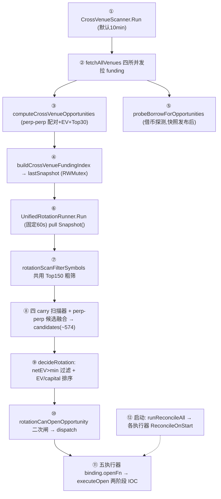

# Lingxi 五策略全链路正向分析与整改（2026-06-20）

> **方法论**：本文**从数据采集第一步开始，正向逐段分析每一道工序到下一道工序是否最优**，而不是从"开不出仓"这个结果倒推原因。
> 每个结论都标注**代码位置**与**运行日志证据**。最后结合外部 review 意见给出整改优先级。
> 数据来源：`records/lingxi_server.log`（截至 2026-06-20 08:15）、`records/opportunities/unified_candidates.jsonl`、`records/crossvenue/`。

---

## 0. 一句话结论（先给判断）

系统工程件齐全，但**作为"五策略统一交易大脑"尚未闭环**。当前最硬的事实：

> **连续 116 轮决策，`actions=0` 占 116/116（100%）。**

这不是某个参数调错，而是**正向管道有 5 处结构性断点**，每一处都让"上一道工序的输出不是下一道工序的最优输入"：

1. **采集与消费周期错配**（10min 扫描 vs 60s 轮动，最长吃 30min 旧快照）
2. **输入池被污染**（574 候选里绝大多数是早拒诊断对象，不是可开机会）
3. **perp-perp 被 Top30 提前截断**（116/116 轮恒为 30，组合层看不到全集）
4. **扫描 EV 与执行 EV 口径不一致**（固定 bps vs 深度模拟）+ **固定 $150 名义算死极端币**
5. **恢复闭环未收口**（MNT 残腿被两套策略重复扫描/flatten）

---

## 1. 系统正向数据流（先建立全景）



装配入口：`internal/app/run.go:129-188`，scanner 与 runner 是**两个独立 goroutine 共享同一指针**，纯 pull 模型。

---

## 2. 逐段正向分析：每一步到下一步是否最优

### 段 ① → ②：采集周期 vs 消费周期

| 项 | 实现 | 代码位置 | 是否最优 |
|---|---|---|---|
| Scanner 周期 | `ScanIntervalMinutes`，默认 **10min** | `cross_venue_scanner.go:344-346`、`defaults.go:316` | ⚠️ 对整点 funding spike 偏慢 |
| Runner 周期 | 硬编码 **60s** | `unified_rotation_runner.go:548-550` | — |
| 快照过旧闸 | runner **30min** 才 skip | `unified_rotation_runner.go:19,552-557` | ❌ 最长可吃 30min 前的费率 |
| executor 开仓闸 | `MaxSnapshotAgeSeconds` 默认 **720s** | `cross_venue_executor.go:860-865`、`defaults.go:317` | ⚠️ 两层阈值不一致 |

**日志证据**：扫描快照 ID 时间戳与决策时间差普遍 10–25min，例如
`08:13:14 决策` 用的是 `snapshot=cvsnap-20260620T074309`（**约 30 分钟前**）。

**问题**：H-USDT 这类极端费率在整点结算前后变化极快（见段⑪日志，spreadAPR 在 691%~1198% 间剧烈跳动），**用 10–30min 前的快照做决策，本身就不是最优输入**。

---

### 段 ② → ③：四所采集 → perp-perp 配对

| 项 | 实现 | 代码位置 | 是否最优 |
|---|---|---|---|
| 四所并发 | goroutine + WaitGroup，binance/bybit/okx/gate | `cross_venue_scanner.go:700-761` | ✅ 合理 |
| 超时 | 默认 45s，OKX 120s | `cross_venue_scanner.go:27-28` | ✅ 合理 |
| 单所失败降级 | 只记 status，不阻塞其它所 | `cross_venue_scanner.go:700-761` | ✅ 合理 |
| 配对 | `bestPairSpread` 用 `RawAnnualizedAPR`（已修复单腿封顶压平 bug） | `cross_venue_scanner.go:1003-1041` | ✅ 已修好 |
| NextFundingTime 缺失 | `now+interval` 兜底推算 | `cross_venue_scanner.go:71-80` | ✅ 已修好 |

**这一段目前基本最优**——历史上的两个 bug（单腿 500% 封顶压平价差、1h 合约缺 NextFundingTime 被跳过）已修复。H 现在能稳定 `paired=true`。

---

### 段 ③：perp-perp EV 估算 + Top30 截断 ❌ 核心断点

| 子步 | 实现 | 代码位置 | 是否最优 |
|---|---|---|---|
| 名义 | 固定 `MaxPositionUSDT=150` | `config.yaml:65`、`cross_venue_scanner.go:1129` | ❌ 未按 netEV 搜索 |
| 滑点 | `crossVenueExpectedSlippageUSDT` = 4腿 × 20bps 固定 | `cross_venue_rotation.go:184-190,355` | ❌ 与执行闸口径不一致 |
| funding 收入 | 12h hold × 50% capture 折损 | `cross_venue_gates.go:381-388`、`cross_venue_spot_perp_scanner.go:24` | ⚠️ 极端币被系统性压低 |
| 排序 | `RankScore = NetEV` | `cross_venue_rotation.go:408-411` | ⚠️ 与轮动层 EV/capital 口径不一致 |
| **截断** | `opps[:topN]`，topN=30 | `cross_venue_scanner.go:1147-1150` | ❌ **组合层吃不到全集** |

**日志证据（116/116 轮 perp_perp 恒为 30）**：
```
perp_perp=30  ×116 轮  ← Top30 截断铁证
```

**H-USDT 实测（08:15 一轮，$150 名义）**：
```
spreadAPR=691% paired=true entered=true
netEV=-1.0014  inTop30=false  topNTruncated=true
cost: spreadEV=0.71 open=0.16 close=0.16 slip=1.20 obsRisk=0.04 policy=0.03
```

**三重叠加把 H 算死**：
1. `slip=1.20` 恒定（与 spreadAPR 无关，纯 `20bps×4×150` 配置常数）——证明扫描期**没接深度滑点**
2. 固定 $150 名义——spreadEV 才 $0.71，但滑点固定 $1.20
3. netEV<0 → rankScore=0 → 挤不进 Top30 → **根本不进统一轮动候选池**

**这是 H「必须吃到」却吃不到的真正链路位置**：不是滑点天然大，是"固定大名义 + 固定高滑点 + 提前截断"三连击。

---

### 段 ⑤：借币探测

| 项 | 实现 | 代码位置 | 是否最优 |
|---|---|---|---|
| 触发 | 快照发布**之后**才 probe | `cross_venue_scanner.go:427-431` | ⚠️ runner 可能读到空 BorrowProbes |
| 预算 | 每轮 live 上限 30，缓存 TTL 20min | `cross_venue_scanner.go:448-609` | ⚠️ 覆盖率渐进，不全 |
| 目标 | Top10 机会 + Top60 负 funding | `cross_venue_scanner.go:448-609` | ⚠️ ~70 symbol，非全市场 |

**问题**：borrow probe 覆盖率不足直接导致 **cvps 大面积 `not_borrowable`**（见段⑧日志）。

---

### 段 ⑥ → ⑦：快照消费 + 共用 Top150 粗筛

| 项 | 实现 | 代码位置 | 是否最优 |
|---|---|---|---|
| 粗筛 | `rotationScanFilterSymbols` 取 `funding×√liquidity` Top150 | `unified_rotation_runner.go:842-875` | ⚠️ 极端/薄币可能进不了 150 |
| 适用范围 | **只卡四 carry**；perp-perp 不走粗筛 | `unified_rotation_runner.go:910-921` | ❌ 五策略输入层不对称 |

**问题**：carry 四策略与 perp-perp 的数据路径不对称——perp-perp 全市场扫但被 Top30 截，carry 走 Top150 粗筛但拿全量进轮动。"五策略公平比较"在输入层就不成立。

---

### 段 ⑧：五策略各自扫描 → 候选融合 ❌ 输入池污染 + 两策略死亡

**日志证据（最近一轮 `cvsnap-074309`, 08:13）**：
```
candidates=582 (svsp=301 cvsp=0 svps=249 cvps=0 perp_perp=30)
```

#### SVSP（单所 spot-perp）：301 候选，正 EV = 0
- 只收正费率；负费率 → `negative_funding_v1_not_supported`
- 代码：`single_venue_spot_perp_scanner.go:232-235`
- 死因 top：`no_spot_market`(188) / `negative_funding_v1_not_supported`(140)
- **大量是早拒诊断对象，ExpectedNetEVUSDT=0 也进了 candidates**

#### SVPS（单所 perp-spot）：249 候选，正 EV = 0
- 只收负费率；正费率 → `positive_funding_v1_not_supported`（reverse 默认关）
- 代码：`single_venue_perp_spot_scanner.go:236-239`、`defaults.go:393`
- 死因 top：`positive_funding_v1_not_supported`(167) / `not_borrowable`(49)

#### CVSP（跨所 spot-perp）：**0 候选** ❌
- 漏斗（08:13）：`pair_attempts=63 → build_settlements=58 → emitted_tradable=0`
- 漏斗（07:53）：`pair_attempts=62 → build_funding_window=50 build_funding_ev=8 → emitted=0`
- 代码：`cross_venue_spot_perp_scanner.go:507-516`（funding window 闸）
- **死因在 `funding_window` 与 `settlements`，不是没 alpha**

#### CVPS（跨所 perp-spot）：**0 候选** ❌
- 漏斗（08:13）：`pair_attempts=57 → build_not_borrowable=56 → emitted_tradable=0`
- 代码：`cross_venue_perp_spot_scanner.go:372-381`、借币检查
- **死因几乎全是 `not_borrowable`——借币基础设施不通，非策略无效**

#### 候选融合
- 代码：`unified_rotation_runner.go:1015-1019,1025-1038`
- 全量 candidates（含早拒对象）一起进 `DecideRotation`
- `unified_candidates.jsonl` 累计：svsp/svps 各万级、perp_perp 782 条、**cvsp/cvps 近期 0 tradable**

**断点本质**：决策器吃的是"574 个扫描对象"，不是"574 个可开机会"。决策器在替扫描器清垃圾。

---

### 段 ⑨ → ⑩：决策 + 二次开仓闸

| 项 | 实现 | 代码位置 | 是否最优 |
|---|---|---|---|
| 正 EV 过滤 | `ExpectedNetEVUSDT > minProfit` | `unified_rotation.go:511-518` | — |
| 排序 | `unifiedWindowScore = NetEV / totalCapital`（**资本效率**） | `unified_rotation.go:178-184,519-525` | ❌ 与 perp-perp 的 NetEV 排序矛盾 |
| 二次闸 | `rotationCanOpenOpportunity`（cooldown/min_notional/net_ev/max_concurrent/余额/budget） | `unified_rotation.go:446-493` | ✅ 逻辑合理 |
| soft reject | 仅 `net_ev<=0`、`requires_rebalance` 当软标记 | `unified_rotation.go:288-292` | ⚠️ 早拒 hard reason 仍占池 |

**日志证据**：116/116 轮 `actions=0`。最近一轮 574 候选 `positive_ev=0`——**全系统无正 EV 可开**，不是排序问题，是输入池没有正 EV 对象。

**目标函数矛盾（已确认）**：
- 统一轮动主排序：`EV / capital`（资本效率）
- perp-perp 扫描排序：`NetEV`（绝对 EV）
- **两套口径混用，系统"到底优化什么"自相矛盾**

---

### 段 ⑪：执行（两阶段 IOC）

| 项 | 实现 | 代码位置 | 是否最优 |
|---|---|---|---|
| 入口 | 各执行器 `executeOpen(ctx, opp, live)` | `single_venue_spot_perp_executor.go:397` 等 | ✅ |
| 腿序 | carry 先开主腿→对冲腿；cross 先开永续/借币腿 | `carry_open_protocol.go` + 各 executor | ✅ |
| 执行闸滑点 | `crossVenuePerpPerpEVSlippageLegs` **深度模拟** | `cross_venue_slippage.go:152-177`、`cross_venue_gates.go:229` | ⚠️ 与扫描期固定 bps 不一致 |
| live/OFF 分叉 | `openLive()` false → dispatch 跳过 OPEN | `unified_rotation_runner.go:325-343,1161-1166` | ✅ |
| 回滚 | Leg2 失败回滚 Leg1；查单未知不自动回滚 | 各 executor | ✅ 稳健 |

**断点**：同一笔 perp-perp，**扫描期用固定 20bps×4 算 EV，执行闸用深度模拟算 EV**——会出现"扫描排名好、执行一算翻负"或反之，两段口径必须统一。

---

### 段 ⑫：启动恢复闭环 ❌ MNT 重复 flatten

| 项 | 实现 | 代码位置 | 是否最优 |
|---|---|---|---|
| 调度 | `runReconcileAll` 启动时一次，固定顺序 | `unified_rotation_runner.go:443-482` | ✅ |
| 永续腿去重 | `carryPerpLegSkipUntrackedScan` 跨策略归属检查 | `position_dust.go:343` | ✅ 有去重 |
| **现货腿去重** | 只查本策略台账，**无跨策略去重** | `position_dust.go:372-385` | ❌ **会重复** |
| recent-flatten registry | **无** | — | ❌ 缺失 |
| dust band | `DustCloseThresholdUSDT` 默认 1.0 | `position_dust.go:15,288` | ✅ 有 |
| flatten 二次核验 | 冷启动 untracked flatten **fire-and-forget** | `flattenUntrackedLeg` | ❌ 无核验 |

**日志铁证（同一时刻、两套策略各扫一次同一残腿）**：
```
2026/06/19 19:09:09 [同所spot-perp] reconcile: venue=bybit 未登记 spot MNT-USDT≈18.431550
2026/06/19 19:09:09 [跨所spot-perp] reconcile: venue=bybit 未登记 spot MNT-USDT≈18.431550
```
该现象在日志中出现 **14 次**，且每次都是 SVSP + CVSP 成对出现。

**断点本质**：现货 orphan 无统一归属 + 无去重 + flatten 无二次核验。当前默认 `UntrackedExposureAction=halt` 暂时遮住了重复 *下单*（只重复告警），但一旦切 `flatten`，**同一残腿会被两套策略各卖一次**——这是会真花钱的生存性问题。

---

## 3. 正向分析汇总：5 个结构性断点

| # | 断点 | 段 | 证据 | 严重度 |
|---|---|---|---|---|
| B1 | 采集/消费周期错配，吃旧快照 | ①→⑥ | 决策用 30min 前快照 | 中 |
| B2 | 输入池污染（诊断对象混入决策） | ⑧→⑨ | 574 候选 positive_ev=0 | **高** |
| B3 | perp-perp Top30 提前截断 | ③→⑥ | perp_perp=30 ×116轮 | **高** |
| B4 | 扫描/执行 EV 口径不一致 + 固定 $150 | ③/⑪ | slip=1.20 恒定, H netEV<0 | **高** |
| B5 | 恢复闭环未收口（MNT 重复） | ⑫ | SVSP+CVSP 同刻扫 MNT ×14 | **高（生存性）** |
| 附 | cvsp/cvps 基础设施死亡 | ⑧ | cvsp=0 cvps=0 ×116轮 | 高 |
| 附 | 目标函数矛盾（EV vs 资本效率） | ⑨ | 两套排序口径 | 中 |

---

## 4. 与外部 review 意见的对照

外部 review 给了 P0–P6 七项建议。**与上面正向分析逐条对照，方向高度一致**：

| review 项 | 对应断点 | 我的核对结论 |
|---|---|---|
| **P0** 把 628 拆成可解释数字 | B2 | ✅ 必做，止盲。当前 `would_execute` 用扫描器口径 ≠ 轮动口径，需分两层 |
| **P1** 拒绝对象/可交易候选分离 | B2 | ✅ 当前最优解。runner 层过滤即可，不必大改签名 |
| **P2** 修 cvsp/cvps 真实死亡点 | 附 | ✅ 证实：cvsp 死 funding_window/settlements，cvps 死 not_borrowable |
| **P3** perp-perp 三连（Top30/notional/深度滑点） | B3+B4 | ✅ 最值钱一组，证据最硬 |
| **P4** 统一目标函数 | 目标矛盾 | ✅ 证实代码混用 EV/capital 与 NetEV，需用户拍板 |
| **P5** 修 MNT 重复 flatten | B5 | ✅ 证实 14 次成对扫描，优先级应上调 |
| **P6** watchlist/reverse funding | — | ✅ 放最后正确，先止盲再扩 universe |

**结论：review 意见不是空谈，与代码/日志高度吻合，可作为整改主线。**

---

## 5. 整改方案（P0–P6，含我的优先级修正）

> 总原则：**先止盲（P0）→ 去污（P1）→ 修主战场 perp-perp（P3）→ 收口恢复（P5）→ 补基础设施（P2）→ 定目标（P4）→ 扩 universe（P6）**。

### P0：把候选数变成可解释结构（止盲，最先）
- **改**：`unified_rotation_runner.go`、`unified_rotation.go`、`unified_candidates_log.go`
- **做**：`scanRotationCandidates` 后打印 `raw_total/raw_by_strategy/would_execute_total/would_execute_by_strategy/soft_reject_count/hard_reject_count`；`DecideRotation` 前对每个候选跑只诊断的 `rotationCanOpenOpportunity`，累计拒绝分布；落 `rotation_decision_diag.jsonl`
- **关键**：区分 `scanner_would_execute`（`len(RejectReasons)==0`）与 `rotation_would_execute`（过 `rotationCanOpenOpportunity`），当前是混的

### P1：输入池去污（决策只吃可开候选）
- **改**：四 carry 扫描器 + `unified_rotation_runner.go`
- **做**：runner 汇总时 `rotationCandidates = filter(无 hard reject 且 netEV>min 且 capital>0)`；`diagnosticCandidates = all` 仍写 jsonl/面板；`DecideRotation` 只吃 `rotationCandidates`
- **注意**：仅 soft reject（net_ev<=0）的也不该进 rotationCandidates

### P3：perp-perp 三连（提前到 P1 之后立刻做）
- **改**：`cross_venue_scanner.go`、`cross_venue_rotation.go`、`liquidity_sizing.go`、`unified_rotation_runner.go`
- **做法1（最高优先）取消 Top30**：scanner 保留全量 opps；面板/leaderboard 单独取 TopN 展示；runner 读全量
- **做法2（最高优先）notional 搜索**：对每个候选在 `25/50/75/100/150/tradable_cap` 搜 netEV 最大且满足深度/步进约束的名义
- **做法3 深度滑点对齐**：扫描期 `ExpectedSlippageUSDT` 改用与执行闸同口径的深度估算，消除"扫描好/执行翻负"
- **证据**：H 在 $150 上 netEV=-1.0，slip 恒 1.20；小名义+深度滑点可能转正

### P5：修 MNT 重复 flatten（若 live，与 P0 并行）
- **改**：`single_venue_spot_perp_executor.go`、`cross_venue_spot_perp_executor.go`、`position_dust.go`
- **做**：现货 orphan 改为**统一 spot-orphan reconciler 扫一次**再按归属分配；加 `recent_flatten_registry`（venue,symbol,side,qty_band + 时间窗）；flatten 后**强制二次核验**，未平标记 `unresolved_orphan`
- **证据**：MNT-USDT 被 SVSP+CVSP 同刻扫 14 次

### P2：修 cvsp/cvps 死亡点（基础设施）
- **改**：`cross_venue_spot_perp_scanner.go`、`cross_venue_perp_spot_scanner.go`、`carry_open_protocol.go`、`unified_rotation_runner.go`
- **做**：funding_window 拒绝打穿透日志（symbol/next_funding_time/hold_hours/expected_funding/entry_cost/threshold）；borrow probe 出可用率统计（coverage_by_venue/known_true_rate/unknown_rate）；粗筛后做 venue-specific instrument 有效性前置过滤
- **不该**：先一股脑放松门，先量化死亡分布再决定调哪个门

### P4：统一目标函数（需用户先拍板）
- **改**：`unified_rotation.go`、`unified_opportunity.go`
- **做**：二选一——绝对净收益(`ExpectedNetEVUSDT`) 或 有限资本窗口收益(window score/capital efficiency)；日志/面板写明 `primary_score/net_ev/capital_efficiency/selected_reason`
- **建议**：几百 U 账户务实选资本效率；但与"极端币必吃"目标需取舍（H 是高 EV/低资本效率），可给 watchlist 保底 slot

### P6：watchlist + reverse funding（最后）
- **改**：`unified_rotation_runner.go`、单所扫描器配置
- **做**：`rotationScanFilterSymbols()` 后加 watchlist union（H/BTT/PEPE 即使不进 150 也二次扫）；`SingleVenueReverseFundingEnabled` 改按 venue/symbol/regime 可控

---

## 6. 附：配置层反噬（P0 做完必撞）

正向分析发现，很多候选不是算法挡的，是**配置自己焊死的**：

| 配置 | 位置 | 反噬 |
|---|---|---|
| `strategy_mode: profit_seeking` | `config.yaml:11` | 强制 `min_net≥0.002` + impact reserve，系统性压低 would_execute |
| `max_cycle_open_notional_usdt: 60` | `config.yaml:26` | vs `max_position_usdt:150`，候选转正也可能开不出 |
| `SingleVenueReverseFundingEnabled:false` | `defaults.go:393` | 单所策略锁死方向，H 类负费率走不通单所 |
| perp-perp 不走 Top150 粗筛 | `unified_rotation_runner.go` | 五策略输入层不对称 |

---

## 7. 实施顺序与验收标准

### 实施顺序（含优先级修正）

| 阶段 | 内容 | 目标 |
|---|---|---|
| 第 1 周 | P0 + P1（+ P5 若 live 并行） | 把"574 候选"拆成真实结构；去污；收口冷启动 flatten |
| 第 2 周 | P3 Top30 + notional 搜索（紧接 P1）+ P2 | 让 would_execute 候选稳定出现 |
| 第 3 周 | P3 深度滑点对齐 + P4（先拍板目标函数） | 消除扫描/执行口径不一致；统一排序 |
| 第 4 周 | P6 watchlist / reverse funding | 扩大机会空间 |

> 相对 review 原顺序的调整：**P3 Top30 提前**（H 等不起）、**P5 提前/并行**（生存性风险）、**P4 前置拍板**（目标取向是用户决策）。

### 验收标准（7 条，不是看日志更热闹）

1. `would_execute_total > 0`，且连续多周期成立
2. cvsp/cvps `emitted_tradable` 不再长期为 0
3. perp-perp 不再"高 spread 但固定 150 算死且被 Top30 截断"
4. `actions=0` 从 116/116 常态变成少数市场窗口现象
5. MNT 类未登记腿不再跨两套策略重复 flatten
6. 每轮日志能直接读出"574 里 `rotation_would_execute=?`，死因 top3=?"
7. `would_execute` 不再混用 scanner / rotation 口径

---

## 8. 用户决策（已锁定，2026-06-20）

1. **P4 目标取向 = 绝对净收益**：全链主排序统一用 `ExpectedNetEVUSDT`；资本效率降为次级 tiebreaker + 日志展示。理由：账户本金长期闲置（116 轮 held=0），瓶颈是机会稀缺而非本金稀缺，绝对美元优先；且极端币绝对 EV 大，绝对排序能让其在主排行胜出。
2. **极端币不设保底 slot**：极端币是主要收入来源，直接在主排行按绝对 EV **公平竞争**，不做保底位。P6 只做 watchlist **union 进扫描**（H/BTT/PEPE 即使不进 Top150 也被扫到），排序仍按绝对 EV。
3. **起步范围 = A + B 核心**：P0 止盲 + P1 去污 + P3 全部三连（Top30 取消 + notional 搜索 + 深度滑点对齐）一起上。
4. **P5 与 P0 并行**：MNT 重复 flatten 是生存性问题，不等第 3 周。

> 函数级落地清单见 `IMPLEMENTATION_PLAN_AB_20260620.md`。

---

## 附录：关键代码位置索引

| 环节 | 文件:行号 |
|---|---|
| 进程装配 | `internal/app/run.go:129-188` |
| 采集主循环 | `cross_venue_scanner.go:339-432` |
| 四所并发拉取 | `cross_venue_scanner.go:700-761` |
| perp-perp 配对 | `cross_venue_scanner.go:1003-1041` |
| perp-perp EV + Top30 | `cross_venue_scanner.go:1086-1152` |
| perp-perp EV 成本模型 | `cross_venue_rotation.go:340-405` |
| 扫描滑点(固定) | `cross_venue_rotation.go:184-190` |
| 执行滑点(深度) | `cross_venue_slippage.go:152-177` |
| 借币探测 | `cross_venue_scanner.go:448-609` |
| 快照消费 | `unified_rotation_runner.go:586-634` |
| Top150 粗筛 | `unified_rotation_runner.go:842-875` |
| 五策略扫描融合 | `unified_rotation_runner.go:885-1059` |
| 决策排序 | `unified_rotation.go:178-184,511-527` |
| 开仓闸 | `unified_rotation.go:446-493` |
| 四 carry 扫描器 | `{single,cross}_venue_{spot_perp,perp_spot}_scanner.go` |
| carry 开仓协议 | `carry_open_protocol.go` |
| 启动恢复 | `unified_rotation_runner.go:443-482` |
| 未登记腿扫描 | `position_dust.go:288-507` |
| dust 阈值 | `position_dust.go:15-68` |
| 配置默认值 | `internal/core/defaults.go:314-393` |
| 用户配置 | `config.yaml` |
